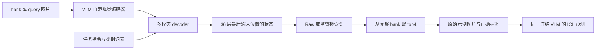

# BehaviorICL：当前研究整合

最新完整/部分结果与执行状态见 [CURRENT_RESULTS.md](CURRENT_RESULTS.md)及 [HANDOFF.md](HANDOFF.md)：本地TAM、小bank检索和InternVL面板已完成；InternVL动态全量六方法仍在运行。下文2026-10-06的暂停/未运行陈述属于历史整合。

> 本文保留本地 GPU 实验前的项目整合快照。新完成的五数据集 TAM 与检索消融及更新后的论文 claim 见 [LOCAL_GPU_STUDY.md](LOCAL_GPU_STUDY.md)。

> GitHub接手版：仓库内链接可移植；原科学source/audit字节保留。完整本地归档、图片、权重及云运行状态不在此仓库，参见 [artifact availability](handoff/ARTIFACTS.md)。

更新：2026-10-06。实验和自动监督已按人类要求暂停；此文是当前主入口，替代此前按运行时间累积的项目介绍。

## 1. 我们现在要回答的问题

**视觉上相似的图片，是否就是目标 VLM 最适合使用的 demonstration？**

外部图像编码器提供的相似性，未必与目标 VLM 在某个具体任务中的上下文利用方式一致。我们的想法是：让目标 VLM 自己处理任务文本和图片，取出它在回答之前的逐层内部状态，再据此检索示例。相似性由目标模型、当前任务和图片共同定义。

建议的论文概括：

> BehaviorICL retrieves demonstrations using the target VLM's task-conditioned, layerwise pre-answer states. It measures similarity in the model's internal response to the task and image, then supplies the retrieved examples to the same frozen VLM for in-context prediction.

这里的“decision 过程”应具体写成 **layerwise pre-answer states / 逐层回答前状态**。当前实现没有提取整段生成推理、CoT 或完整决策轨迹，也没有直接测量“模型理解了什么”。“整个 decision 过程”可以表达动机，但作为方法描述会超过实际实现。

## 2. 方法实际做了什么

目标模型是固定版本的 **Qwen3-VL-4B-Instruct**。每张 bank/query 图片与任务指令、完整合法类别词表一起输入冻结的 VLM。在开始生成答案前，提取最后一个输入位置在 36 个 decoder 层的 hidden state，每层 2560 维。embedding 层不计入这 36 层。

**有视觉编码器。** 图片先经过 VLM 自带的视觉模块，再进入多模态 decoder。BehaviorICL 用 decoder 的任务条件化状态进行检索；decoder 的第一层不能直接称为视觉编码器。RICES 使用外部 CLIP 图像特征，是比较基线。

| 版本 | 检索表示与学习 | 对应问题 |
|---|---|---|
| BehaviorICL-Raw | 每层状态 L2 归一化，36 层 cosine 等权平均；无训练 | 目标 VLM 的逐层状态本身是否适合检索？ |
| BehaviorICL-Proj | 所有层共享一个 256 维线性投影，层权重固定等权；bank 标签 SupCon | 监督度量学习能进一步改善示例选择吗？ |
| BehaviorICL-Learn | 同一共享投影，加上可学习的 softmax 层权重；bank 标签 SupCon | 学习层的重要性是否带来额外收益？ |

共同协议：4-shot；学习投影固定 256 维；训练使用 bank 内每类 10 个 dev 样本选择最早达到最佳 dev 的 checkpoint，训练 1500 步；最终候选是完整 bank。测试标签只用于评估。检索后按原固定顺序把四张示例图片及标签交给同一 VLM，进行合法类别约束的 greedy 预测。

评分可以概括为各层投影后 cosine 的加权和：Raw 的投影为恒等变换，Proj 的层权重等权，Learn 的层权重可学习。当前方法用原始逐层状态，**不使用早期相邻层差分 velocity**。详细函数和必要旧文件依赖见 [代码地图](CURRENT_CODE.md)。

## 3. 已完成的证据分别说明什么

| 证据 | 已完成范围与核心结果 | 可以支持的判断 |
|---|---|---|
| 主分类表 | 五数据集完整 test，六方法，seed 73；Raw/Proj/Learn 等数据集均值 83.46/85.71/85.82%，RICES 75.09% | 当前表示和检索协议有实用效果；三 seed 稳定性仍待验证 |
| 任务提示 vs 通用提示 | DTD+CUB 完整 test，任务条件化 source 带来 +5.11/+34.29 pp | 任务指令与类别词表的联合条件化对检索有用 |
| 固定 demo 标签干预 | DTD+CUB 完整 test；可用配对中 Gold−own +18.96/+44.78 pp；另有五组×256样本 | 固定上下文中的正确标签显著影响上下文效用 |
| 纠错及 strict-match | 五组完整回顾分析，保留 rescue、harm、非法输出和未知 match | 可描述检索覆盖与纠错关联；不能独立证明 same-failure 因果机制 |
| QwenVision+SupCon | 仅 DTD+CUB；85.32/84.33%；相对历史 Proj −0.59/+0.97 pp | 单纯监督视觉表示也很强；不支持 decoder 表示普遍更优 |
| QV 与 Proj 匹配比较 | CUB Proj strict 覆盖更高，QV 总 rescue 反而更高 | 覆盖无法单独解释性能 |

完整数值、配对 CI、实际分母和 SHA 审计见 [结果整合](CURRENT_RESULTS.md)。任务提示与标签干预的原始结果均已取回；它们不是仅有远端摘要。QV 的 source、checkpoint、预测和完整归档也已取回并独立核验。

**QwenVision+SupCon 是单独的视觉控制，不是“RICES → QwenVision → SupCon”的串联流程。** 它用目标模型视觉模块的 pooled feature 训练固定 256 维检索头，再取 top4 做相同任务的 ICL。它的结果要求我们把贡献放在任务条件化检索与实证证据上，而非“decoder 一定比视觉编码器好”。

## 4. 用户最新提出的解释实验：改变 query 看 TAM

当前优先问题是：**同一图片配不同 query，模型的空间响应和逐层状态是否变化？这种变化是否能帮助理解任务提示对照中的收益？**

已找到并固定官方 [xmed-lab/TAM](https://github.com/xmed-lab/TAM) 代码。协议锁定 DTD/CUB 各 4 图，分别覆盖历史 task-only、generic-only、都对、都错四个分层；按 SHA 固定选图，不按热图是否好看筛选。每图四个 query，以自然生成和固定金标签 teacher-forcing 两种模式探测，共 64 runs。

准备的输出包括 raw CAM、TAM 的 ECI 校正后图、实际 token IDs/视觉 grid，以及同一最后输入位置的 36 层状态。原始 TAM、索引修正、适配器与 CPU 分析代码均已保存，但 **64 runs 未执行完成，尚无实际热图或机制结论**。最近一次云启动在 container 初始化期限内未取得 SSH，已停机；没有运行 native worker。

必须同时注意三点：TAM 不是 attention weights；自然生成词不同会改变所可视化的目标；image token 放在 query 前时，因果 decoder 中同一固定目标的 raw image CAM 可能不随后面的 query 改变。此时应分别看 raw CAM、ECI 校正和回答前状态，不能把校正后图的差异直接解释成“视觉注意发生移动”。

原任务提示实验改变的是 **检索 source 的 prompt**，随后改变 demo，最终 ICL 任务 query 保持一致。因此 TAM 是机制线索，仍需把“prompt → 表示 → 检索示例 → ICL 输出”的链条连接起来。

## 5. 目前不能省略的限制

主表是单 seed；任务提示同时改变任务指令和类别词表，未单独分解两者；标签实验的 own 标签有预定缺失，Gold−own 用可用 query 配对。P0 自由 zero 与约束 ICL 的解码口径不同，历史环境/batch 也与新实验有差异。

strict-match 用真类别及合法错误类别做事后定义，属于分析代理，不是在线检索规则。unknown 不等于没有 match。固定同类别 demo 数量的控制没有一致支持独立 same-failure 作用；GPT-MM 的覆盖反例和 QV 的反例必须保留。正确标签仍有 harm。不能把这些分析写成独立因果证明。

当前贡献候选是 **目标 VLM 的任务条件化逐层状态检索 + bank-only 的轻量度量学习 + 完整的提示/上下文/纠错证据**。足够的 novelty 还需系统对照已有 model-aware retrieval、hidden-state retrieval 和多模态示例选择工作；目前没有证据支持“首次利用整个 decision 过程”的强主张。

## 6. 停在哪里、下一步是什么

当前 **0 个运行 GPU，自动监督 PAUSED**。提示、标签、QV 等已完成实验不重跑。InternVL 五组和 Qwen 新增 seed 74/75 未完成，且均低于当前 TAM 优先级；没有可直接重复调用的旧云入口。

恢复工作后的第一目标是取得可靠的 TAM/逐层状态对照，再连接已有任务提示实验的 demo 变化。三 seed 和第二 VLM 用于稳定性及跨模型推广验证，待人类重新确定优先级后继续。明确的交付、完成条件与工程缺口见 [下一步](NEXT_STEPS.md)。

本次整合只调整文档和索引。原代码、科学锁、审计、结果与失败盘未删除；早期探索和历次启动排障退出主阅读路径。[整理前原文归档](handoff/ARTIFACTS.md#local-history) 和 [证据索引](analysis/current_project_consolidation_v1/evidence_index.json) 保留全部来源。
